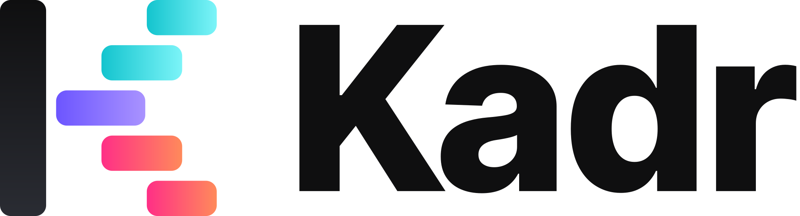

<a href="README.md">English</a> · <b>Українська</b>

  <picture>
    <source media="(prefers-color-scheme: dark)" srcset="assets/logo.svg">
    
  </picture>

<h3 align="center">Дайте тему. Отримайте готове відео.</h3>

  Kadr — відеоредактор для комп’ютера, у якому ШІ робить увесь монтаж: сценарій, озвучення, футаж, моушн-графіку,
  субтитри й музику — на вашій власній підписці Claude або ChatGPT. Вам лишається переглянути результат і натиснути «Рендерити».

  

## Про цей репозиторій

Цей репозиторій лише доставляє **оновлення** встановленим копіям Kadr (Windows і macOS). Kadr перевіряє його сам:
**Налаштування → Оновлення**. Тут зберігаються лише дві останні версії.

Kadr працює з кодом активації. Усе інше — що вміє Kadr, приклади, ціни, як купити й отримати код — на офіційному
сайті: **[kadr.uk](https://kadr.uk/uk/)**.

## Допомога

Пишіть у Telegram: [@J0hnd03](https://t.me/J0hnd03) або в самому Kadr: **Меню → «Повідомити про баг»**.

---

Kadr — програма із закритим кодом, © Kadr. Див. [LICENSE](LICENSE) і
[THIRD_PARTY_NOTICES.md](THIRD_PARTY_NOTICES.md).
